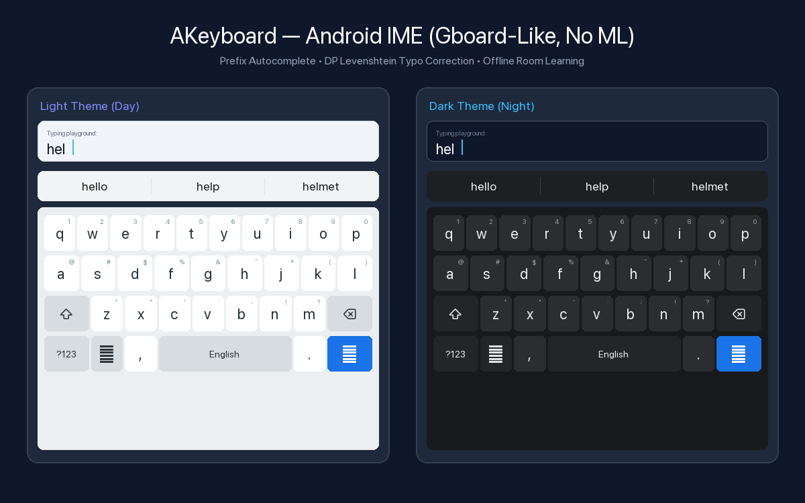

# AKeyboard

Android Input Method Editor (IME) built in Kotlin using classic data structures and dynamic programming. It provides fast autocomplete, typo correction, and local personalization without machine learning or external network access.



## Features

- **Trie Prefix Autocomplete**: Prefix lookups run in $O(\text{prefix length})$ time with top suggestions ranked using an in-memory bounded priority queue.
- **Dynamic Programming Auto-Correction**: Uses Levenshtein distance with adjacent transposition checks (Damerau-Levenshtein), applying branch pruning to evaluate suggestions within edit distance $\le 2$.
- **On-Device Learning**: Stores typed words, frequencies, and timestamps locally using Room (SQLite).
- **QWERTY Layout**: Supports shift, double-tap caps lock, symbol toggles, long-press alternate characters, and repeat backspace.
- **Light & Dark Themes**: Visual styles designed to follow system preferences.
- **100% Offline & Private**: Zero internet permissions requested (`android.permission.INTERNET` is omitted).

## Architecture

The project follows the Android MVVM pattern:

- `ui/`: Custom views for the keyboard layout (`KeyboardView`) and candidate bar (`SuggestionBar`).
- `ime/`: `KeyboardService` (`InputMethodService`) managing `InputConnection` events and text commitments.
- `viewmodel/`: `KeyboardViewModel` tracking composing text buffers, shift state, and suggestion updates via coroutines.
- `domain/`: `AutocompleteEngine` and `AutoCorrectEngine` containing the prediction and typo correction algorithms.
- `data/`: In-memory `Trie`, `DictionaryLoader`, and Room database (`KeyboardDatabase`, `LearnedWordEntity`, `LearnedWordDao`).

## Building from Source

### Prerequisites

- Android SDK (API 26 to 35)
- JDK 17
- Gradle 8.13 (or the included Gradle wrapper `./gradlew`)

### Build Commands

Run unit tests:
```bash
./gradlew testDebugUnitTest
```

Build the debug APK:
```bash
./gradlew assembleDebug
```
The output APK is generated at: `app/build/outputs/apk/debug/app-debug.apk`.

## Installation and Setup

### Method 1: Via ADB

1. Connect your Android device with USB debugging enabled:
   ```bash
   adb install -r app/build/outputs/apk/debug/app-debug.apk
   ```
2. Enable and set the input method:
   ```bash
   adb shell ime enable com.android.keyboard.gboardclone/.ime.KeyboardService
   adb shell ime set com.android.keyboard.gboardclone/.ime.KeyboardService
   ```

### Method 2: Via Companion App UI

1. Open the **AKeyboard** app on your phone.
2. Tap **Step 1: Enable in Settings** and turn on **AKeyboard IME**.
3. Tap **Step 2: Choose as Active IME** and select **AKeyboard**.
4. Test typing in the in-app **Typing Playground**.

## Testing & Quality Verification

The project contains 127 automated unit tests covering:
- Trie insertion, prefix matching, bounded heap suggestion ranking, and concurrency stress testing (`TrieTest`, `DataLayerCornerCasesTest`).
- Dynamic programming distance calculations, true Damerau transposition, and branch pruning (`AutoCorrectEngineTest`, `DomainCornerCasesTest`).
- Dictionary asset integrity, loader edge formats, and alphabet coverage (`DictionaryAssetTest`, `DataLayerCornerCasesTest`).
- Repository ranking, frequency updates, and Room integration (`SuggestionRepositoryTest`, `ViewModelRepositoryCornerCasesTest`).
- ViewModel state management, shift timing, and layout mode transitions (`KeyboardViewModelTest`, `ViewModelRepositoryCornerCasesTest`).

Run all tests with:
```bash
./gradlew testDebugUnitTest --rerun-tasks
```

Generate the JaCoCo coverage report:
```bash
./gradlew createDebugUnitTestCoverageReport
```
The HTML coverage report is saved at `app/build/reports/coverage/test/debug/index.html`.

## Roadmap

See [BACKLOG.md](BACKLOG.md) for planned feature enhancements and backlog items.

## License

This project is licensed under the Apache License, Version 2.0. See [LICENSE](LICENSE) for details.
